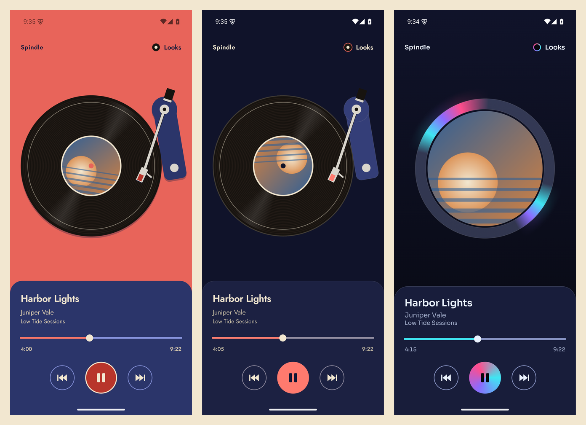
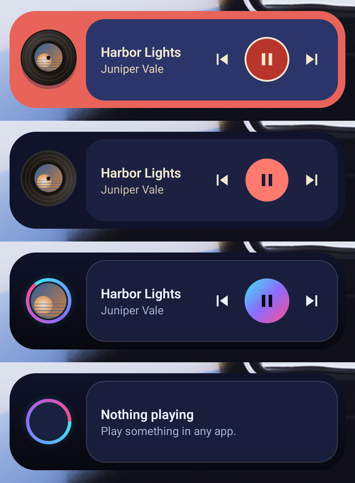

# Spindle

**Turn whatever you're playing into a spinning record you can control.** Spindle is a
vibe-switching music player and home-screen widget for Android. It reads your phone's *live*
media session and renders it as a vinyl deck or a futuristic foil ring. No account, no login,
no keys.




## What it is

Spindle shows the track playing on your phone (Spotify, YouTube Music, podcasts, **anything**
that publishes media controls) with the real album art as the record's center label, live
progress, seek and working transport controls. Pick a **look** to set the vibe; the app
remembers it.

- **No login, no API keys, no account.** Spindle reads Android's system media session, not any
  streaming service's API.
- **Works with free *and* paid** accounts of any supported player.
- **One-time setup:** allow Notification access, the same permission a smartwatch uses to
  control media. Spindle never hears audio and ignores your other notifications.

## Looks

- **Analog**: a two-ink sleeve print (coral and navy) that follows the system Day/Night
  setting. Press play and the tonearm swings over and drops onto the record; pause and it
  lifts back to its rest. The arm tracks the song's progress.
- **Flux**: the album art inside a spinning dichroic foil ring over a glass tray. Dark only.

Switch anytime with the **Looks** button (top right, with a swatch of the current look). More looks are
on the roadmap (see [`design/skin-ideas.md`](design/skin-ideas.md), a catalog of 36).

Motion respects **Remove animations** (Settings, Accessibility): the record and ring stay
still, the arm snaps, and haptics still confirm each action.

## Seek

Tap or drag anywhere on the progress bar. The left time shows where you will land, and Spindle
sends one seek when you let go. Apps that cannot seek show a fixed marker instead; live streams
hide the bar. TalkBack reads it as "Seek, 3:58 of 9:22".

## Home-screen widget



A 4x1 widget in your current look, with album art, title, artist and prev / play-pause / next.
Its record or ring spins only while music plays and rests when paused. It updates once per
change (never per frame) and re-themes as soon as you change the look in the app.

## How it works

Android exposes the active media session through `NotificationListenerService` +
`MediaSessionManager`. Spindle finds the current `MediaController`, reads its metadata and
playback state, and issues transport and seek commands: no streaming SDK, no OAuth. The in-app
player is drawn with Jetpack Compose; the widget uses `RemoteViews` (its ring spins via an
indeterminate progress drawable, the one animation widgets allow).

> **Android only.** iOS provides no public API for a third-party app to read or control another
> app's media session, so this concept can't exist there.

## Build and run

Requires Android Studio (or the Android SDK) and a device or emulator running **Android 8.0+**.

```bash
git clone git@github.com:Priyans-hu/spindle.git
cd spindle
./gradlew :app:assembleDebug
# or open the project in Android Studio and Run
```

On first launch, tap **Allow notification access** and enable Spindle. On Android 13+ a
sideloaded APK may show the switch as restricted: tap **Can't turn it on?** in the app, then
in App info open the menu and choose **Allow restricted settings**.

## Demo mode (debug builds only)

Debug builds include a fake player so you can try Spindle without a music app. It owns a real
media session with three tracks and generated art. Release builds contain none of it.

```bash
adb shell am start -n com.markfoundry.spindle/.MainActivity
adb shell am broadcast -n com.markfoundry.spindle/.demo.DemoReceiver --es cmd start
```

Other commands for `--es cmd`: `stop`, `next`, `seekable_on`, `seekable_off`, and `pin_widget`
(asks the launcher to place the widget). Track 3 is a live stream with no duration.

## Tech

Kotlin, Jetpack Compose, Material 3, DataStore, `MediaSessionManager` / `MediaController`,
`RemoteViews` widget. Type: Jost and Sora (SIL Open Font License, see `design/fonts/`).

## Roadmap

- More looks from the catalog (CD/Discman, cassette, iPod click-wheel, Winamp)
- Tonearm drag-to-seek
- Widget sizes beyond 4x1

See [CHANGELOG.md](CHANGELOG.md) for what changed in each release.

## License

[MIT](LICENSE) (c) 2026 Priyanshu Garg.

Spindle is an independent project and is not affiliated with or endorsed by Spotify or any other
music service; it uses Android's public media APIs only.
